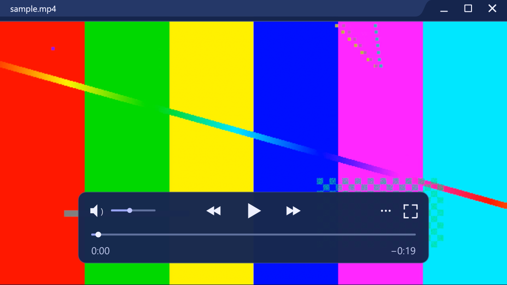
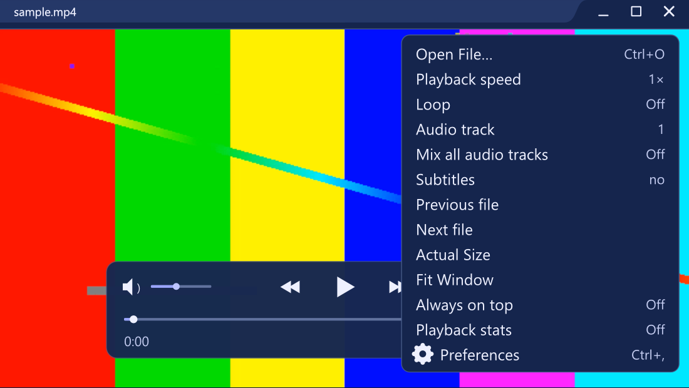
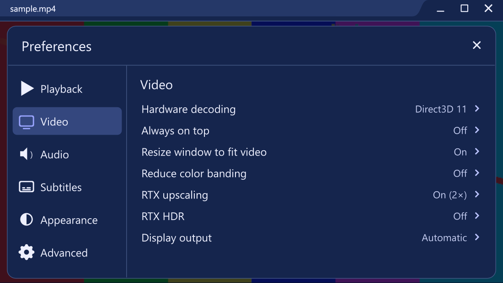
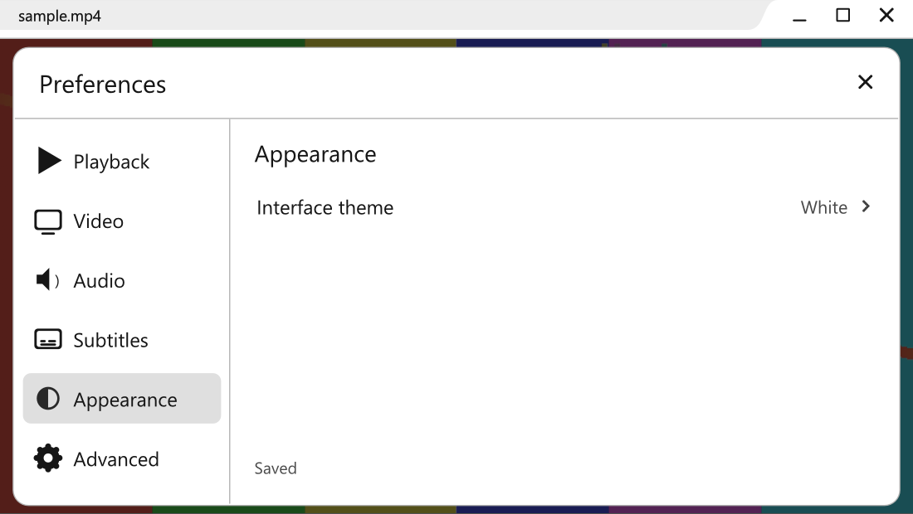

# QuickMPV

QuickMPV is a Windows front end for [mpv](https://mpv.io/) with a compact playback overlay, timeline previews, selectable themes, and support for NVIDIA RTX video processing.

## Screenshots









## Install

Download and run the Windows x64 installer. It installs for your Windows account and adds a Start menu shortcut. Windows 10 or 11 on x64 is required. [Download QuickMPV](https://github.com/technicallyalex/QuickMPV/releases/latest)

On first launch, QuickMPV asks before downloading the mpv engine from shinchiro's Windows builds and checks the download against GitHub's published SHA-256 digest. [mpv Windows builds](https://github.com/shinchiro/mpv-winbuild-cmake/releases)

Open a file with **Ctrl+O** or drag it into the window. Open **Preferences** with **Ctrl+,**. Use **Preferences → Advanced → Check for MPV updates** to check for a newer engine. For more controls, see [the player guide](portable/README.txt).

## Build from source

On Windows, install [7-Zip](https://www.7-zip.org/) in its default location. From the repository root, run these commands in PowerShell:

```powershell
.\build.ps1
.\build-installer.ps1 -AppOnly
```

The first command builds the launcher using the Windows .NET Framework C# compiler. The second builds `QuickMPV-Shareable-Setup.exe`. The shareable installer contains the QuickMPV interface, icon, and launcher. It creates a preferences file on first install and downloads the separate MPV engine on first launch with your approval. Git ignores the `portable/portable_config/quick-preferences.conf` file that holds your local preferences.

For a local installer with an engine included, place `mpv.exe`, `mpv.com`, and your `d3dcompiler_43.dll` in `portable`, then run `build-installer.ps1` without `-AppOnly`.

## License

QuickMPV's original code and icon are available under the [MIT License](LICENSE). The [third-party notices](portable/licenses/THIRD-PARTY-NOTICES.md) credit the independently downloaded mpv engine and its components, the build tools, and the inspiration for timeline previews.
